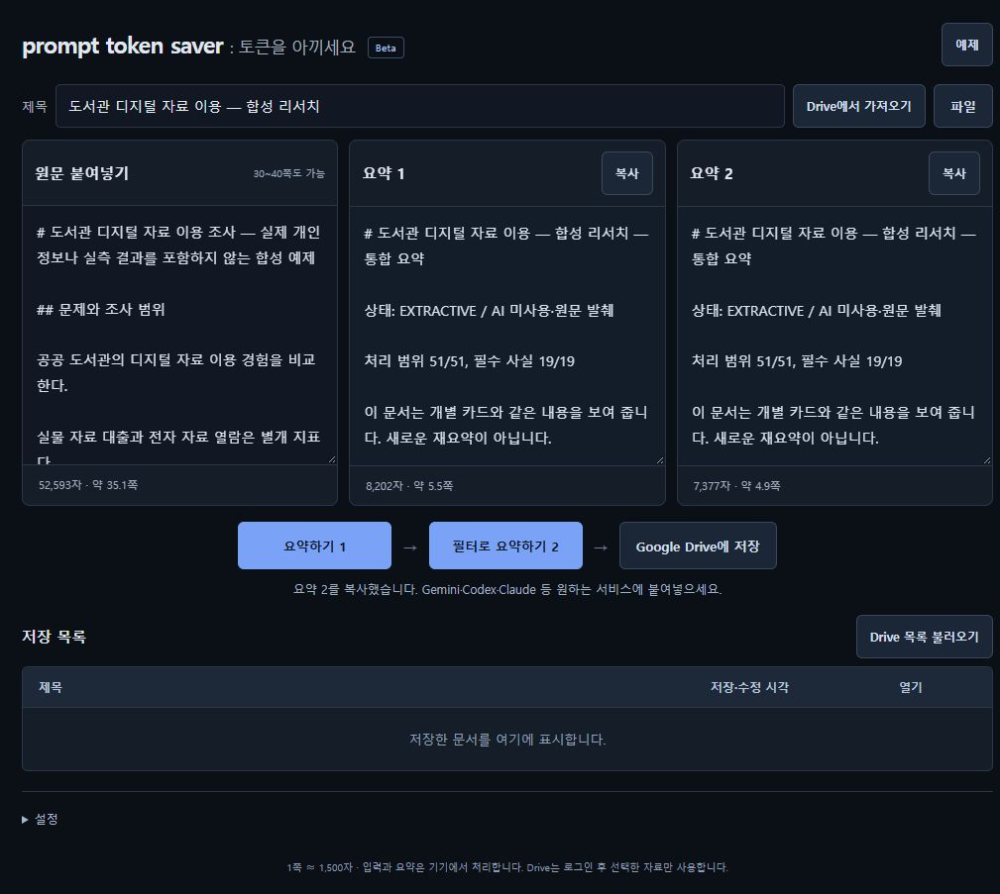

# prompt token saver : Save your tokens

**v0.1.0-beta.1 · Serverless · Tablet / Mobile · Dark Mode**

[한국어](README.ko.md) · [English](README.en.md)

**[Open the public Mobile / Tablet Beta](https://ai-agent-orchestrator.github.io/prompt-token-saver/)**

Open this address on your phone or tablet. No development environment or source download is needed. Use it in the browser, or add it to the home screen as an app.

### Add it to the home screen

- **Android phone/tablet:** open in Chrome → browser menu → **Install app** or **Add to Home screen**.
- **iPhone/iPad:** open in Safari → **Share** → **Add to Home Screen**. Enable “Open as Web App” if offered.
- Launch **token saver** from the home screen. An app-store download or APK is not required.

Google login is optional for paste → Summary 1 → Summary 2 → copy. Initial loading and Drive operations need internet. Actual device installation and offline use remain Beta verification items. See the [PWA installability guide](https://developer.mozilla.org/en-US/docs/Web/Progressive_web_apps/Guides/Making_PWAs_installable).

## Layer 1: ultralight edge — free and serverless

| Item | Product direction |
|---|---|
| **Why it exists** | The lightest outpost for collecting and refining thoughts anywhere, **without worrying about money or heat**. |
| **Cost structure** | **Zero hosting maintenance fees and inference API charges** — free static hosting + on-device computation. |
| **Core stack** | **Tablet + GitHub Pages + LiteRT-LM (`Gemma`) + browser similarity search** |
| **Primary jobs** | • Capture ideas and research notes on the move<br>• Compress and summarize important prompts using surprisal signals<br>• Search local vectors instantly and back up selected material to GitHub |

This table states the **intended core role and development direction**. Reducing heat and battery impact is a goal, not a zero-heat guarantee. Zero cost refers to operation within free static-hosting limits and on-device processing without paid inference APIs.

| Actual Beta status | Availability |
|---|---|
| Text input, Summary 1, filtered Summary 2, copy, Drive connector and saved list | Implemented. The no-Drive path has been checked; real-account Drive testing is separate |
| LiteRT-LM / Gemma | Adapter for compatible local model files is implemented; real Gemma and tablet GPU validation is pending |
| Actual surprisal `−log p(token)` | Not implemented. Current protected extractive rules are not measured surprisal |
| Local browser embeddings and vector similarity search | Planned |
| User-material backup to GitHub | Planned, explicit opt-in. GitHub currently stores application code, not automatic commits of personal source text |

## One screen



```text
Paste source → Summary 1 → filter again: Summary 2 → Save to Google Drive
                                                        ↓
                                                Open from saved list
```

The interface title is **prompt token saver : 토큰을 아끼세요**. There is no separate landing page, dashboard, sidebar, or result screen. Source and both summaries appear side by side on wide tablet screens, and stack on mobile. Execution and save buttons sit above the saved-items table. Optional settings stay collapsed.

For additional AI work, copy the result into Gemini, Codex, Claude, or another service yourself. The app does not connect paid AI APIs or billing.

## Start without Google Drive

**Google login, Drive configuration, and a model file are not required for both summaries and copying.**

1. Open the app and click **예제** (Example), or paste your own source.
2. Click **요약하기 1** (Summary 1).
3. Click **필터로 요약하기 2** (Filter into Summary 2), and compare the two outputs.
4. Click **복사** (Copy) on the result you want to use.

Drive is optional. Only importing a Google document, saving to Drive, or listing remote saved items needs Google configuration and authorization. Missing configuration must not erase a generated summary.

## With Google Drive

The app operator configures a Web OAuth client ID, a restricted Picker API key, and the Google Cloud project number once. Visitors sign in with their own accounts and grant per-file access using `drive.file`.

Select a source document, generate the summaries, and choose **Google Drive에 저장** (Save to Google Drive). Summary 2 is saved when it exists; otherwise Summary 1 is saved. The app creates a new output document and does not overwrite the source. Refresh the saved list to open the app's output folders, which may include incomplete save attempts.

## How serverless processing works

- GitHub Pages or another static host serves application files. The visitor's browser processes the text.
- The default mode uses model-free extractive filtering. It protects numeric relationships, units, negations, conditions, and specified terms. It does not certify real-world truth.
- The second pass filters facts already selected in the first pass and retains the original evidence ledger. It does not reinterpret generated instructions as source facts.
- Source text is not uploaded to a developer backend or committed to GitHub. Google I/O happens only when requested. Login tokens stay in tab memory.
- Optional local recovery stores work only with consent. Browser work, personal masking terms, and models do not automatically synchronize between devices.
- Optional LiteRT-LM uses a user-selected compatible `.litertlm` file. Model weights are not automatically downloaded. This implementation selects exact source evidence; unrestricted paraphrasing and validated semantic checks are not provided.

The target is approximately 5–10 reference pages from 30–40 pages of initial research. One reference page means 1,500 Unicode codepoints, including whitespace; it is not a measured token count or an exact printed page. Important evidence takes priority over forced shortening.

## Beta testing today

This is a **testable Beta**, not a release with completed device/model/Drive validation.

The 2026-11-19 no-Drive browser check processed **52,593 → 8,202 → 7,377 characters** and retained the final condition. Copying and actually pasting the result back on the public HTTPS site confirmed matching text. There was no horizontal overflow at 1024px tablet and 390px mobile widths; mobile input text is 16px. After PWA updates, **70 tests and a production build passed**. These results do not verify installation on a real device or tablet GPU performance.

Start with synthetic or public material. Follow the [Beta start and check record](docs/BETA_CHECKLIST.md): test the no-Drive path first, then add real-account Drive checks after operator configuration. Real device GPU performance, Google account integration, and the deployed Pages URL remain separate verification items.

## Run the Beta branch

With Node.js 24 on a development computer:

```sh
git clone --branch claude/tablet-token-saver-2026-11-19 https://github.com/ai-agent-orchestrator/prompt-token-saver.git
cd prompt-token-saver/apps/tablet
npm ci
npm run dev
```

The printed Local URL is for the development computer. Regular mobile and tablet users should open the public Beta link above; Google configuration is not required for the Example flow.

```sh
npm run check
npm run build
```

`dist/` contains the static output. The live Beta is published from the root of `claude/tablet-beta-pages`; its source is kept separately on `claude/tablet-token-saver-2026-11-19`. The included [manual Pages workflow](.github/workflows/tablet-pages.yml) is an alternative for a future switch to Actions-based publishing, not the current active deployment path. App visitors do not need Node.js or a development server.

- [App setup, Google configuration, and deployment](apps/tablet/README.md)
- [Dark-mode Tablet / Mobile Beta development plan](docs/TABLET_MOBILE_BETA_PLAN.md)
- [Actual reuse boundaries and dependency licenses](apps/tablet/docs/reuse-manifest.md)

The existing Python engine remains in the repository. The current browser application does not claim feature or measured-quality parity with that engine.

## License

[MIT](LICENSE). Optional SDK Apache-2.0 notices and full terms are included in the app's `licenses/` and generated runtime assets. See [third-party notices](NOTICE.md).
