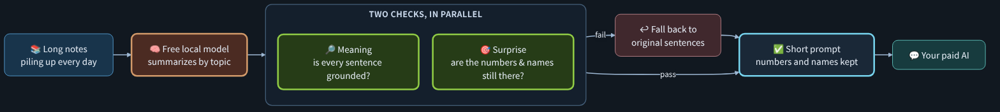

# prompt-token-saver

**프롬프트 토큰은 줄이고, 숫자·사실은 하나도 안 흘립니다.**
무료. 로컬. 10분이면 돌려 봅니다.

[English](README.md)

> 🚧 **공개 개발 중.** 첫 릴리스가 곧 나옵니다. Star나 Watch로 받아 보세요.

## 문제

로컬 소형 모델은 요약을 공짜로 해 줍니다. 그리고 정작 필요한 한 가지를 조용히 흘립니다.

> "3분기 매출은 **12%** 늘어 **41억 원**, *단* 수출 부문 제외."
> → 소형 모델: "3분기 매출이 늘었다." 😐

단어를 지우기만 하는 프롬프트 압축기도 같아요. 짧아지지만 틀려집니다.

## 아이디어

**모델이 맞히지 못하는 말에 정보가 있다.**
"오늘 날씨가 정말 ___" → 쉽게 맞힘, 빠져도 됨. "기준금리를 ___ %로" → 못 맞힘, 반드시 남겨야 함.

그래서 모든 요약은 유료 AI에 가기 전에 두 번, 동시에 검사합니다.

| 검사 | 묻는 것 | 잡는 것 |
| --- | --- | --- |
| 🔎 **의미** | 요약 문장마다 원문 근거가 있나? | 지어낸 문장, 주제 이탈 |
| 🎯 **놀라움** | 맞히기 어려운 말(숫자, 이름)이 남아 있나? | 흘린 사실 |

하나라도 떨어지면 원문 문장으로 대체합니다. **원문보다 나빠지는 일은 없습니다.**

## 받게 될 것

- 주제별로 묶어서 하나씩 요약 (소형 모델은 짧게 줄수록 잘합니다)
- 두 갈래 병렬 검사와 원문 대체
- 모든 판정을 눈으로 보고 기준값을 조정하는 보드
- 내 PC에서 실행. API 키, 가입, 비용 없음

## 상태

| | |
| --- | --- |
| 엔진 | 🛠 개발 중 |
| 데모 (명령 3줄, GPU 불필요) | 🛠 개발 중 |
| 측정 결과 | ⏳ 첫 릴리스와 함께 공개. 재기 전에는 숫자를 쓰지 않습니다 |

## 출처

[LLMLingua](https://github.com/microsoft/LLMLingua)(Microsoft, MIT)의 아이디어(토큰의 놀라움 = 정보량)를 바탕으로 합니다. 서드파티 고지: [NOTICE.md](NOTICE.md).

## 라이선스

[MIT](LICENSE)
