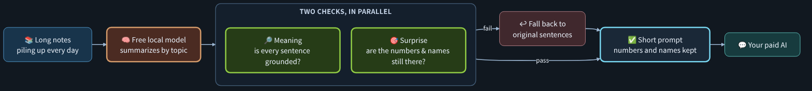

# prompt-token-saver

**Save tokens on every prompt — without dropping a single fact.**
Free. Local. Ten minutes to try.

[한국어](README.ko.md)

> 🚧 **Building in public.** First release coming soon. Star or watch to get it.

## The problem

Small local models summarize for free — and quietly drop the one thing you needed.

> "Q3 revenue grew **12%** to **₩4.1B**, *except* the export division."
> → small model: "Revenue grew in Q3." 😐

Prompt compressors that just delete words have the same problem: shorter, but wrong.

## The idea

**The words a model can't guess are the words that carry information.**
"The weather is really ___" — easy, safe to drop. "Rates moved to ___ %" — impossible to guess, must stay.

So every summary is checked twice, in parallel, before it reaches your paid AI:

| Check | Asks | Catches |
| --- | --- | --- |
| 🔎 **Meaning** | Is every summary sentence grounded in the source? | made-up sentences, topic drift |
| 🎯 **Surprise** | Are the hard-to-guess words (numbers, names) still there? | dropped facts |

Fail either check → fall back to the original sentences. **Never worse than the source.**

## What you get

- Notes grouped by topic, summarized one topic at a time (small models do better on short inputs)
- Two parallel checks, with an extractive fallback
- A board to see every decision and tune the thresholds by eye
- Runs on your PC. No API key, no sign-up, no cost

## Status

| | |
| --- | --- |
| Engine | 🛠 in progress |
| Demo (`3 commands, no GPU`) | 🛠 in progress |
| Measured results | ⏳ will be published with the first release — no numbers until they are measured |

## Credits

Builds on ideas from [LLMLingua](https://github.com/microsoft/LLMLingua) (Microsoft, MIT) — token surprisal as a signal of information. Third-party notices: [NOTICE.md](NOTICE.md).

## License

[MIT](LICENSE)
